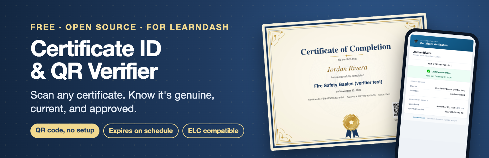
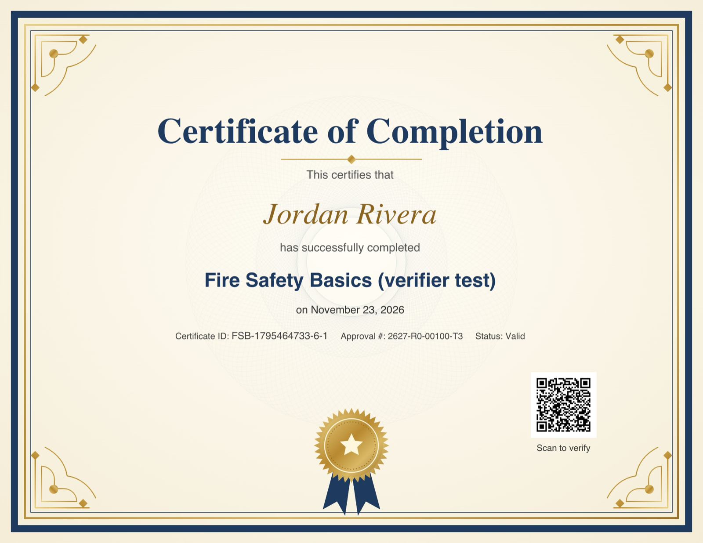
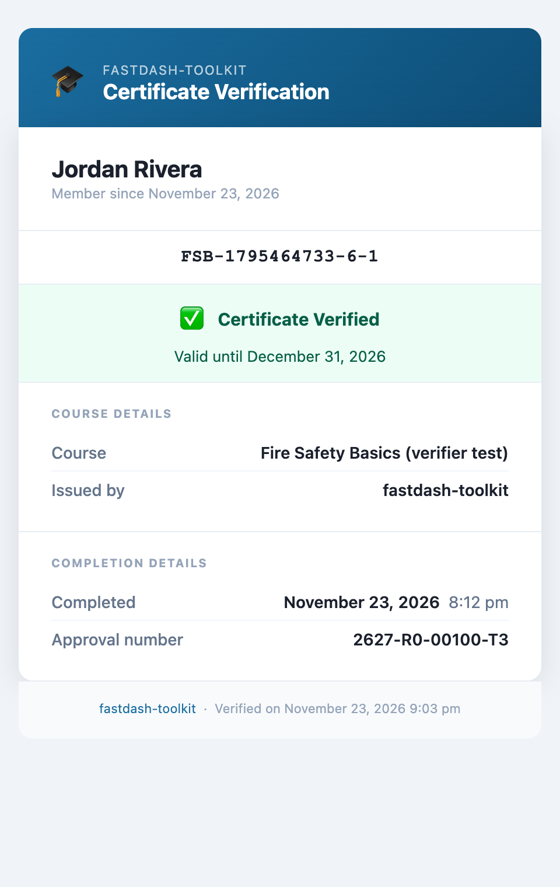
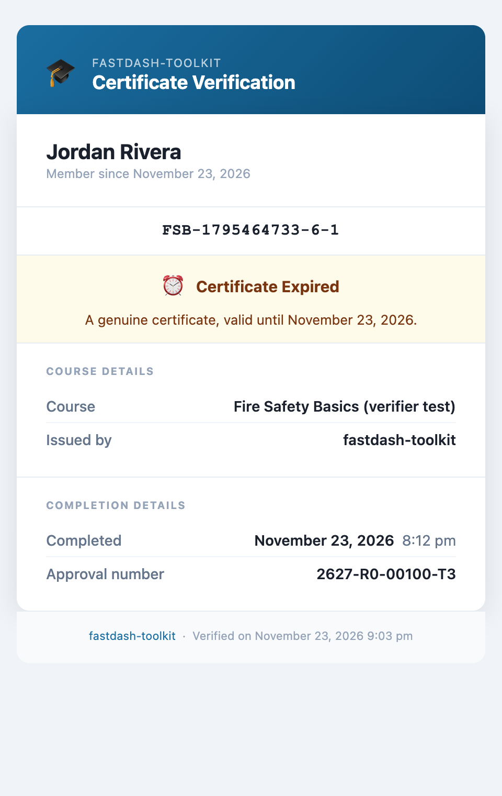
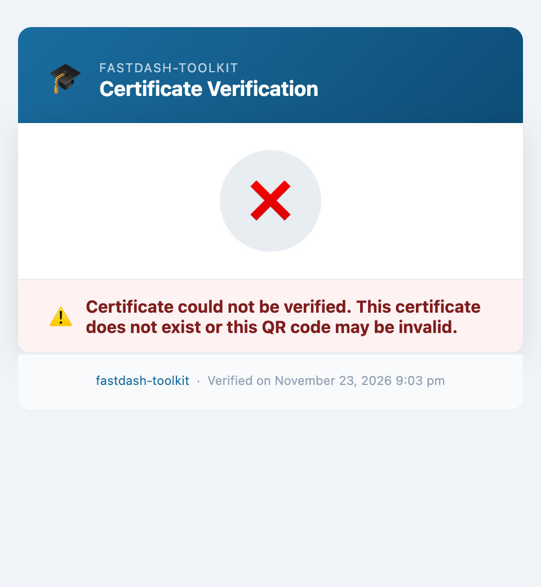
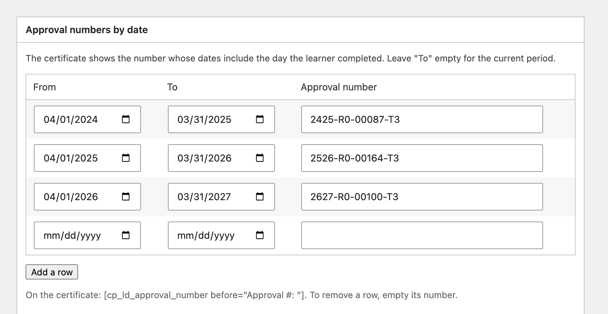
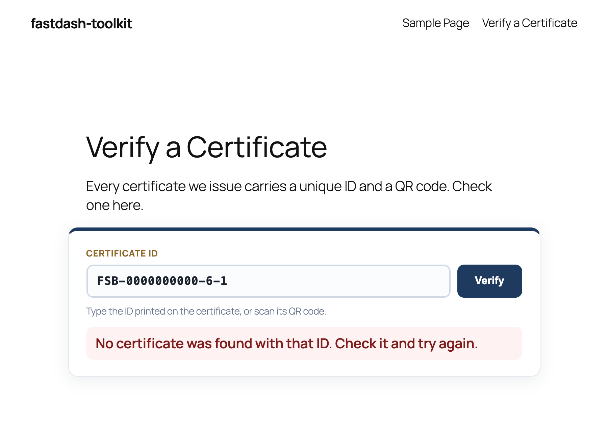

# Certificate ID & QR Verifier for LearnDash



**Scan any LearnDash certificate and know, in a second, that it's genuine, current and approved.**

Every certificate gets a unique ID and a QR code. A phone camera opens a public page that says **Certificate Verified**, with the learner, the course, the completion date and the approval number. When a certification period ends, the same page says **Certificate Expired**. Forged links say **Certificate could not be verified**.

Free and open source (GPL). Made by Patrick Kellogg, founder of eLearning Complete (no longer affiliated with it), who wrote the first certificate tracker and verifier for LearnDash.

[**Download the plugin (zip)**](https://github.com/pfkellogg/certificate-id-qr-verifier-for-learndash/releases/latest/download/certificate-id-qr-verifier-for-learndash.zip) · [Plugin page on aikellogg.com](https://aikellogg.com/#/certificate-verifier)

---

## Why it's different

- **A QR code with no settings page to fill in.** Activate the plugin: every certificate gets a scannable code. No QR service, no API key: the code is made on your own server.
- **Can't be forged.** The link in the code is signed with your site's secret keys. Change one character and it fails.
- **Built for certifications that repeat.** Courses and quizzes that must be retaken every year get dates in one shortcode: the certificate and the verification page say *Valid*, *Expired* or *Not active* by themselves. Next year, change two dates.
- **Approval numbers that follow the calendar.** State boards and accrediting bodies issue a new approval number every period. Each certificate shows the number that was valid on the day the learner finished, forever.
- **eLearning Complete compatible.** Replaces the old *Certificate Tracker* and *Certificate Verifier for LearnDash*: their saved IDs, shortcodes and printed QR codes keep working.
- **Smart shortcodes.** Small, single-purpose shortcodes you drop into any LearnDash certificate.



## The verification page

| Verified | Expired | Forged |
|---|---|---|
|  |  |  |

The QR code opens it straight away. Visitors can also type an ID into the search box ([below](#search-box)).

## Install

1. Install and activate **LearnDash**, and give a course, quiz or group a certificate.
2. [Download the zip](https://github.com/pfkellogg/certificate-id-qr-verifier-for-learndash/releases/latest/download/certificate-id-qr-verifier-for-learndash.zip), then **Plugins → Add New → Upload Plugin**, and activate.
3. That's all: certificates now carry a QR code in the bottom-right corner. Add the shortcodes below to place things yourself.

Requires WordPress 6.0+, PHP 7.4+, LearnDash (built-in PDF certificates).

## Shortcodes

Put these in a LearnDash certificate (**LearnDash LMS → Certificates**). Positions are in millimetres from the top-left corner of the page.

### `[cp_ld_certificate]`: the QR code

```
[cp_ld_certificate qr_x="211" qr_y="148" qr_size="26" show_url="1"]
```

| Attribute | What it does | Default |
|---|---|---|
| `qr_x`, `qr_y` | Where the code goes (mm) | bottom-right corner |
| `qr_size` | Its size (mm) | 32 |
| `show_url` | `1` prints the verification link under it | off |

### `[cp_ld_certificate_id]`: the unique ID

```
[cp_ld_certificate_id prefix="FSB" size="4.4"]
```

Prints `FSB-1795464733-6-1` (prefix, completion time, course, learner). The verification page shows the same ID.

| Attribute | What it does | Default |
|---|---|---|
| `prefix` | Letters and digits in front | `CERT` |
| `size` | Font size (mm) | 5 |

### `[cp_ld_certificate_status]`: valid, expired or not active

The low-maintenance shortcode for certifications that repeat.

```
[cp_ld_certificate_status start="2026-01-01" end="2027-01-01"]
```

| Learner completed… | Prints |
|---|---|
| before `start` | `expired` text (default **Expired**) |
| from `start` up to `end` | `valid` text (default **Valid**) |
| at or after `end` | `not_active` text (default **Not active**) |

And once `end` has passed, a certificate completed in the period says **Expired** when it's viewed, and its verification page says **Certificate Expired** (*A genuine certificate, valid until …*).

| Attribute | What it does | Default |
|---|---|---|
| `start`, `end` | A Unix timestamp, or a date like `2026-12-31 23:59:59` in the site's time zone (Settings → General). `end` itself isn't included. Leave `end` out for "no end yet". | none |
| `expired`, `valid`, `not_active` | Your own wording | Expired / Valid / Not active |
| `step` | A lesson or topic ID: use its completion instead of the course's | the course |

```
[cp_ld_certificate_status start="2026-01-01" end="2027-01-01" valid="Valid through December 31, 2026" expired="EXPIRED – please renew"]
```

Next year: `start="2027-01-01" end="2028-01-01"`. Nothing else to change: the verification page reads the dates from this shortcode.

### `[cp_ld_approval_number]`: the approval number of the day

On each course, quiz or group, fill in **Approval numbers by date** (one row per period):



```
[cp_ld_approval_number before="Approval #: " default="Pending"]
```

The certificate shows the number whose dates include the completion day: a learner who finished in March 2026 keeps *2526-R0-00164-T3*; one who finished in April gets *2627-R0-00100-T3*. If no period covers the day it prints nothing (or `default`). The verification page shows it too.

### `[cp_ld_certificate_expires]`: an expiry date

```
[cp_ld_certificate_expires years="1"]          → November 23, 2027
[cp_ld_certificate_expires days="365" format="d-m-Y"]
```

### Search box

Put `[cp_ld_certificate_search]` on any page (for example *Verify a Certificate*):



## How the addresses work

| What | Address |
|---|---|
| Your search page | `https://yoursite.com/verify-a-certificate/` (any page with the shortcode) |
| After typing an ID | `https://yoursite.com/verify-a-certificate/?certificate_id=FSB-1795464733-6-1` |
| A real ID goes to | `https://yoursite.com/?cp_ld_verify=1&ctid=FSB-1795464733-6-1` |
| The QR code opens | `https://yoursite.com/?cp_ld_verify=1&uid=1&cid=6&sig=c148b942e59e31faa99b` |

`sig` is an HMAC-SHA256 signature made with the site's `auth` salt. Nothing extra is stored in the database.

## Moving from eLearning Complete's Certificate Tracker & Verifier

Deactivate *Certificate Tracker for LearnDash* and *Certificate Verifier for LearnDash* and keep everything else as it is:

| The old plugins | Now |
|---|---|
| IDs saved in the user meta `elc_certificate_ids` | Still verify, with their original completion date (even after a course is reset and retaken) |
| `[elc_certificate_id prefix="…"]` | Prints the same IDs as before, and keeps saving them |
| QR codes from `[su_qrcode]` (Shortcodes Ultimate) with `?certificate_id=` | New ones still carry the ID; old printed ones still work. No second QR code is added to those templates. |
| The verification page with `[elc_ssc_front_search]` | Becomes the search box; old QR links go straight to the verification page |

The saved record is never deleted, not even when this plugin is.

## A free certificate background

[`samples/certificate-background-landscape.jpg`](samples/certificate-background-landscape.jpg): US Letter landscape, 200 dpi, navy and gold with a seal. Set the certificate to **Letter / Landscape** in its LearnDash settings and make this its featured image. (The HTML it's drawn from is next to it, to change the colours.)

## Optional: a learner photo

**Settings → Certificate Verifier** can require a photo of the learner on certificates and the verification page, uploaded with the **Certificate Photo Upload** block. It's off by default. When it's on, learners without a photo use their Gravatar (loaded from gravatar.com).

## Privacy

The verification page is public by design. It shows the learner's name, the course, completion details, the approval number and (only with photos on) their photo. Never their email address. With the photo off, the plugin contacts no outside service.

## Notes

- Works with LearnDash's built-in PDF certificates. The Certificate Builder add-on isn't supported yet.
- If the FastDash/SlashDash Toolkit's Certificate Verifier module is active too, use one or the other: the plugin warns on the admin screens.

---

LearnDash is a trademark of its owner. This plugin is independent: it is not made or endorsed by LearnDash, nor by eLearning Complete. GPL-2.0-or-later.
